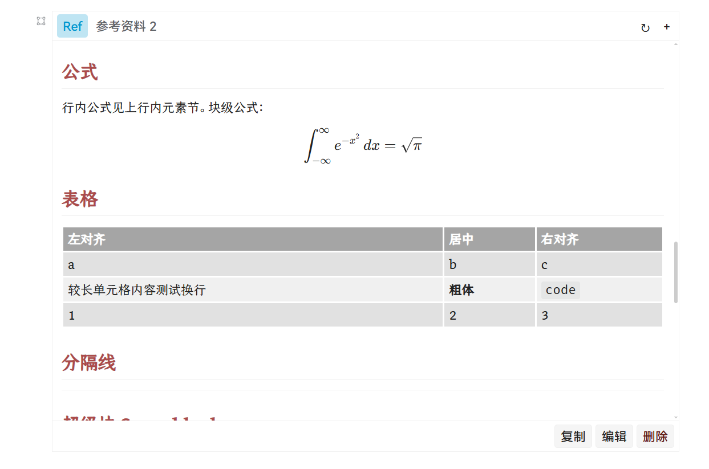
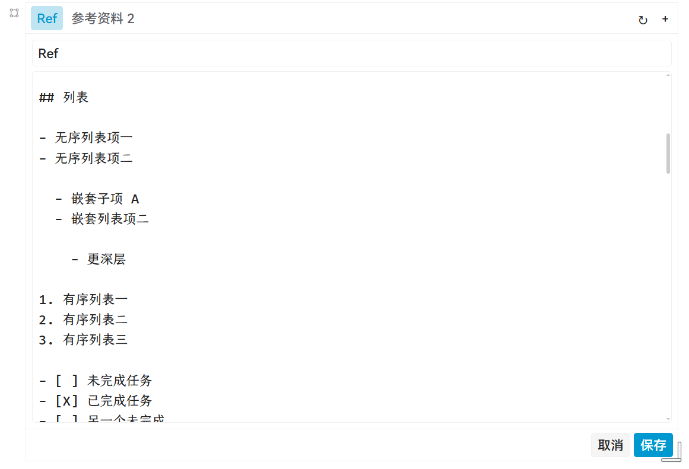

# Markdown Reference

本挂件面向一个常见需求：复制 AI 等外部 Markdown 进入思源笔记，但不想要作为笔记的一部分，而仅仅用于某种只读的参考。

在这种场景下，复制到笔记内容里是极大的浪费：思源会把复制进来的 md 文本转换为 block 结构 、做索引，在文本量大的时候还会开启动态加载。

但很多时候，用户仅仅只需要复制一份低价值的 AGENT 输出当作某个参考。如果不加限制，AI 的输出很容易把笔记库灌满污染。

一个简单的思路是：把 ai 的 slop 输出放到 asset 文件里，然后在笔记中展示即可 —— 这就是这个挂件所做的事情。

你可以把它类比为：创建一个 markdown 的 asset file，然后插入笔记中 —— 只是自带渲染，可以看到内容。

特点:

1. 渲染效果和当前主题保持一致
2. 支持 Latex 公式渲染
3. 支持多 Tab

